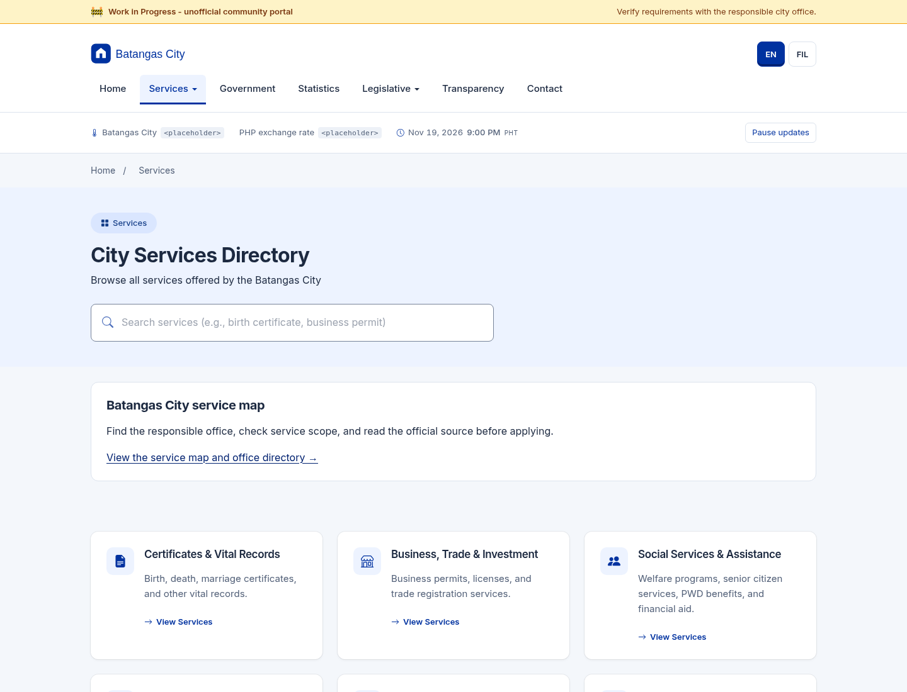
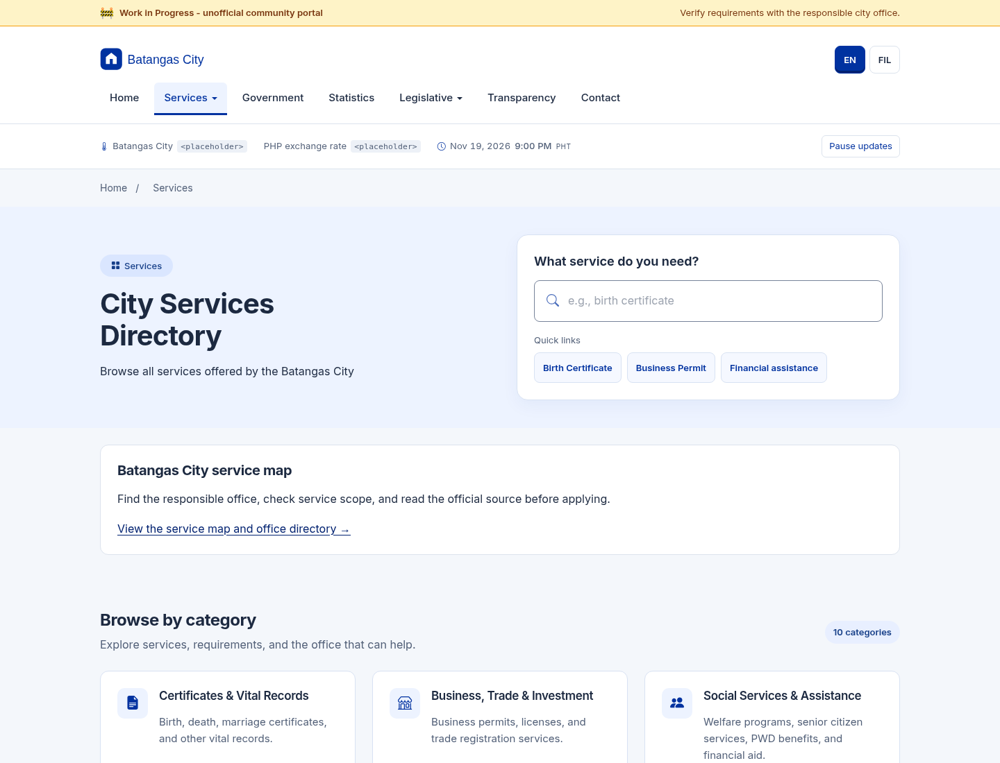
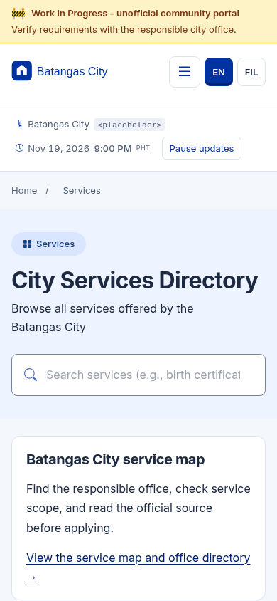
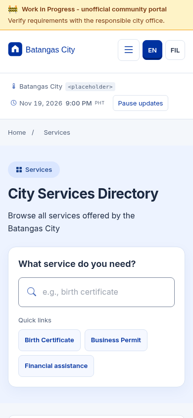

# Services directory: before and after

The directory previously put search beneath the introduction, used a long hint that clipped on phones, and offered only category browsing before the life-event links farther down the page.

The new entry point pairs the introduction with a labeled search panel and direct links to birth certificate guidance, business permit guidance, and financial assistance. Search keeps its existing autocomplete behavior. A category heading, description, and count explain the next browsing option, and category card actions align at the bottom of each row.

All new text supports English and Filipino. The existing work-in-progress notice and Charter-backed service map remain available. This change does not imply that applications can be submitted through the portal.

## Desktop (1440 × 1100)

| Before                                             | After                                            |
| -------------------------------------------------- | ------------------------------------------------ |
|  |  |

## Mobile (390 × 844)

| Before                                                   | After                                                  |
| -------------------------------------------------------- | ------------------------------------------------------ |
|  |  |

## Capture conditions

Before: `4b52b67587f1d401c9bdf95afcbf585c63b7aa89` (the main branch at implementation time). After: this PR. Both use the rendered development server, headless system Chromium, local assets, blocked external HTTPS requests, reduced motion, blocked service workers, fresh browser contexts, and a fixed clock of 2026-11-19 21:00 Asia/Manila. Screenshots use the same viewport and scroll position.

The requested `better-ui`, `better-interface`, and `better-layout` skills were unavailable in the environment; the review was performed directly against the rendered UI.
